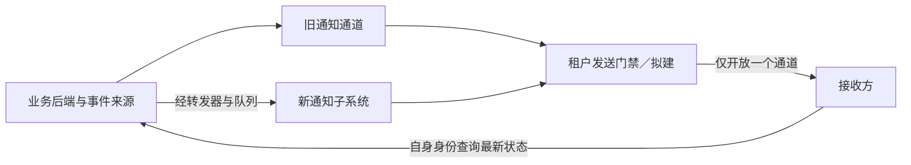
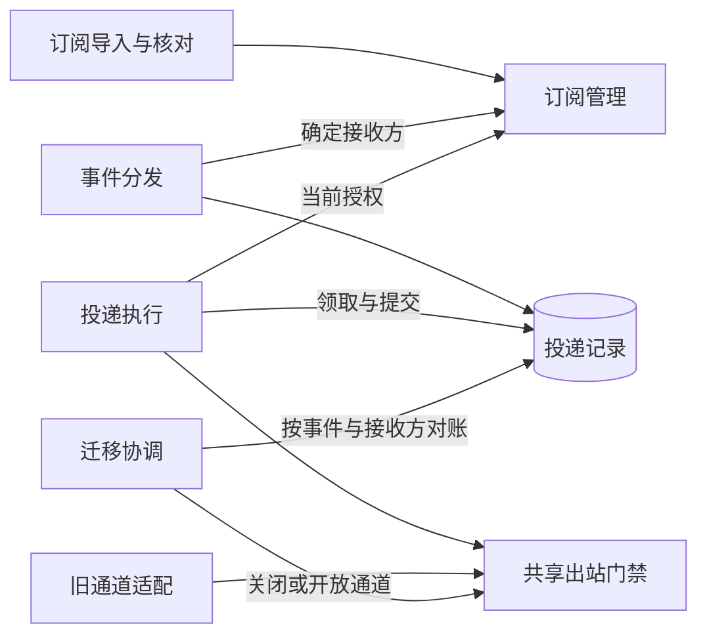

# “多接收方通知改造”项目——通知子系统交付架构

**用途：** 供开发和实施人员评审、实现与验证的具体交付架构。  
**状态：** 目标方案草案；新增机制尚待评审和验证，没有上线批准或验收结果。  
**依据：** 仅使用所供《完整文档评估材料：通知子系统》。这是合成案例，材料中的现状不是实测结论。本文将既有约束与建议方案分别说明；未提供上线日期、项目负责人及验收负责人姓名。

## 1. 职责、范围与父系统约束

项目把试点租户从每个对象只配置一个接收方的旧通道，迁移到支持多个接收方的通知子系统。交付对象仍是业务协作系统内由消息组负责的通知子系统，不新建业务状态权威。业务平台组负责对象状态、修订号和事件，试点租户应用负责人确认各自接收方能够正确处理重复通知。

既有业务后端每次变更都在同一事务中保存新状态和待发送事件；事件经转发器进入允许重复和乱序的队列。通知子系统按订阅生成投递记录，通过 HTTPS 提示接收方发生变化。接收方使用自己的身份查询业务后端，通知确认只表示收到。项目必须保留这些含义。

本次设计覆盖订阅导入、影子检查、真实发送、租户切换、兼容回退与验证。详细部署命令、完整接口字段表和任务排期不在范围内。长期架构由父系统与消息组共同约束；本文中的项目门禁与迁移记录不自动成为已接受的稳定架构。可对照同批形成的[通知子系统长期架构草案](stable.md)，但该草案本身也不构成已批准权威；实际父系统架构及机器定义链接未提供。

项目的首要不变量是同一租户同一时段只有一个通道发起真实发送。业务事件、队列消息和投递表记录不能因切换被清空；发生订阅撤销时，迁移不能恢复已经撤销的权限。由于已发通知无法撤回，回退需要保留发送证据并允许重复，不能以“恢复旧配置”代替未送达义务的交接。

## 2. 外部协作与关键保证

业务平台组提供可追踪的业务事件来源。事件包含租户、对象标识、修订号、事件标识和发生时间，不包含完整敏感业务内容。项目建议旧、新路径均关联这些事件身份；旧路径是否已经具有可对账的事件和接收方标识，材料没有说明，这是切换设计的重要实施前提。

发送门禁是本项目建议的共享控制点，图中不是已存在的设施。所有真实出站请求都必须经过它；只有在两条路径均不能绕过门禁时，租户级单通道保证才成立。影子运行可以读取事件、计算接收方和模拟分发，但不能获得真实发送许可。

新通道入口校验服务身份与租户范围，订阅管理按对象范围选择接收方，发送前再次确认当前授权。调用成功、投递成功与业务完成是三个不同的完成点：入口成功代表事件可靠接纳，HTTPS 确认代表接收方收到，业务处理结果需要由接收方及业务后端另行判断。

例如接收方先收到修订12、后收到修订11，可以忽略旧通知；发现新修订时向后端查询最新状态。项目要求它不把重复事件解释为新的业务操作，但没有依据指定它内部使用哪种数据库更新算法。试点应用负责人必须用实际应用验证该合同。

建议保留旧接收方现有的通知格式与确认语义，通过发送适配层把共同事件映射为兼容通知。新接收方使用同一事件身份和修订含义。旧格式是否可表达这些信息、能否识别重复，尚需核对；无法证明兼容时不得以导入配置成功作为迁移成功。

## 3. 内部方案与职责边界

新通知子系统包括订阅管理、事件分发和投递执行。消息组负责三者及投递恢复，业务平台组仍负责事件产生和查询。项目另外增加迁移协调功能，用于管理每个试点租户的通道状态、发送代次及对账进度。

订阅导入把旧接收方配置转化为新订阅，不负责决定业务对象状态。建议导入记录保留旧配置标识、目标订阅身份和版本，以便重复导入时更新同一映射。一次迁移期间仍可能有配置变化，故不能用一次全量复制覆盖后续撤销。项目需指定一个写入权威：建议迁移租户先由消息组协调冻结旧配置编辑入口，新订阅成为授权变更入口，旧通道发送也读取该授权结果；冻结期间的变更通过受控迁移入口记录并应用。只有配置修改被约束，核对才有明确基线。

迁移协调与投递执行分开，避免工作进程各自决定通道启停。发送门禁持有租户当前开放通道和代次，旧、新发送适配器只能提交与其匹配的请求。门禁在实际出站处验证许可；工作进程在内存中读到旧状态，不能据此自行发 HTTP。实现可以复用现有平台服务与网络控制，但是否具备阻断绕行路径的能力必须验证。

相比仅修改两个通道的配置开关，共享门禁多了一个依赖和状态协调成本，却能够把“停止领取”和“停止真实发送”区别开来。仅停新任务领取时，旧进程仍可持有已领取任务并继续发送，不能满足互斥要求。若共享门禁无法可靠隔离旧进程，应选择暂时停止该租户通知、保留积压，待出站能力已被确实收回再切换。

参考采用方面，项目采用来源给出的事务事件、独立投递记录和修订查询合同；为适应切换，补充租户门禁、对账记录和兼容适配。没有外部参考架构或既有已批准决策可供引用，这些补充均是待确认设计。

## 4. 数据与状态设计

每条投递义务对应一个事件与一个接收方，按租户隔离查找和更新。建议使用数据库唯一约束阻止重复分发；事件标识是否全局唯一未提供，因此不能省略租户限定。一次事件首次分发时，建议在本地事务内保存接收方集合、插入投递记录并标记事件分发完成，然后才确认队列消息。重复消息不再次扩展这个集合；对新订阅是否补发历史事件，需要显式补发决定。

投递记录沿用待发送、发送中、已确认、待重试、人工处理五种状态。工作进程原子领取到期记录并置为发送中，成功确认后转已确认；暂时失败或超时结果未知时转待重试，达到上限转人工处理。人工批准重放后回到待重试。订阅撤销的未发送记录建议进入人工处理并标记停止原因为授权撤销，不能记成已确认或自动继续尝试。

为阻止迟到的旧进程覆盖结果，建议领取时增加单调递增的租约代次。续租和结果提交均检查持有者、代次与数据库时间下的租约有效期。过期后新的领取产生更高代次，旧提交被条件更新拒绝。发送尝试仍可能重复，因为数据库条件不能撤回对端已收到的请求。

租户通道控制建议采用下列状态，并将每次变更与操作者、原因和前后代次一起持久化：

| 租户状态 | 可以真实发送的路径 | 主要作用 |
| --- | --- | --- |
| 旧通道运行／新通道影子 | 旧通道 | 完成订阅及事件映射核对 |
| 切换关闭中 | 不再接纳新的发送；等待原通道在途任务隔离 | 建立交接屏障 |
| 已关闭待交接 | 无 | 对账与转交未完成义务 |
| 新通道运行 | 新通道 | 执行迁移后投递 |
| 回退关闭中／已关闭待回退 | 与切换相同的关闭语义 | 保留新通道结果并重新分配义务 |
| 旧通道兼容恢复 | 旧通道 | 仅在回退覆盖条件满足时开放 |

控制记录、投递任务上的通道代次、门禁持有的开放代次必须一致。建议控制记录存入现有关系数据库，通过条件更新串行化一次租户切换。发送门禁若无法读取可信状态，应停止该租户出站；不能在数据库断联时无限延用旧许可。

迁移对账记录保存事件、接收方、来源通道、已知投递结果、未知结果和交接去向。它不创建新的业务事件，也不把影子计算误记为真实确认。影子投递记录建议与真实记录隔离，启用新通道时以原事件身份正式建立或合并真实义务，防止“影子已处理”抑制实际发送。

队列与关系数据库之间不假设分布式事务。队列消息只有在义务落账后才能确认；交接重放使用原事件与接收方键归并。转发器自身仍保留业务待发送记录的恢复能力。材料未提供历史事件与旧发送证据的保留期限，迁移前必须保留覆盖整个交接与回退窗口的记录；不能在对账闭合前清理它们。

## 5. 关键流程与实现机制

以试点租户某对象产生修订11的事件甲为例。该对象原接收方为甲应用，新订阅另有乙应用。以下是目标机制推演。

1. 业务后端事务提交状态和事件甲，转发器投递队列。入口验证服务身份及租户后，分发事务为甲、乙分别建立真实投递记录。若租户尚处影子阶段，同样的分发只产生隔离的比对结果，不发送。
2. 新通道运行时，工作进程领取甲应用记录，获得租约代次，并读取当前订阅授权。建议授权撤销与发送许可签发在同一订阅状态上串行化；撤销提交后不得签发新许可，许可只适用于当前尝试。
3. 工作进程将该尝试及租户通道代次交给共享门禁。门禁检查当前开放通道、代次及许可有效性，才实际发出 HTTPS 请求。关闭切换门禁、撤销许可或授权状态不可确认时，任务保留并等待处理，不写已确认。
4. 甲应用确认收到，工作进程以当前租约条件提交已确认。甲应用自行比较修订号并查询业务后端。乙应用的记录独立处理，甲的成功不会令乙记录成功。
5. 若乙已收到但响应丢失，结果记为未知，并按原身份重试。如果此时开始切换或回退，未知记录进入交接清单，而不是被归入已送达或丢弃。

发送许可与网络操作之间仍有现实边界。建议门禁在签发后立即执行请求，不允许工作进程把许可缓存后任意延迟使用；订阅撤销使尚未开始的许可失效。已经发起的请求可能在撤销或通道切换后才被对端收到，无法撤回。门禁保证的是新请求的出站资格，不能保证互联网中所有旧请求已经消失。

并发恢复还要同时检查两种代次：投递租约代次保护记录写入，租户通道代次保护发送路径。只有前者时，旧通道仍可能发送；只有后者时，旧工作进程仍可能覆盖新结果。两者必须组合验证。

若在“分发事务已提交、队列尚未确认”处崩溃，再次消费事件甲只能命中已存在的甲、乙记录。若在“HTTPS 已发出、投递结果尚未提交”处崩溃，新进程恢复时保留未知并可能重复发送。前一场景依赖本地事务和唯一约束，后一场景还依赖接收方的重复处理能力，两者不能用同一个“幂等”标签代替机制解释。

## 6. 部署、运行与失败恢复

入口、转发器与工作进程使用现有应用运行平台，队列和关系数据库沿用现有设施。项目建议将迁移协调及发送门禁作为受控服务能力部署，并对旧、新通道的直接出站路径施加限制，使任一通道无法绕过门禁。具体平台网络控制、凭据撤销和进程隔离能力尚无证据，需在切换演练前完成验证。

工作进程可以扩容，但每条投递仍只能由有效租约条件提交。建议设置按租户和接收方的并发限制，避免一个故障下游占满执行能力；限制值需经负载测试确定。数据库故障时停止领取、授权确认与通道切换，队列故障时保留后端待发送事件；门禁故障时暂停出站。任何依赖不可用都不能被记作投递成功。

消息组观察真实队列积压、投递表积压、最老记录年龄、未知结果、重试及人工处理量，并单独观察影子分发差异、门禁拒绝量和切换关闭中的在途尝试。租户门禁已关闭但仍出现该通道发起新请求，是机制失效信号，应停止交接并保留证据。业务平台组负责后端查询恢复，不能由通知恢复替代。

人工重放需要重新校验租户、当前订阅与当前通道，保留原事件和接收方身份。审计必须记录操作者、对象、原因、时间和结果，不存正文；建议审计意图与重放状态变更同事务提交。租户切换本身也应采用同样的受控审计，记录代次和交接依据。审计期限尚待确定。

运行恢复不能只重启进程。消息组应以持久化控制状态判断上一次切换停在哪一步；处于已关闭待交接状态时，恢复服务不能自动开放某一通道。只有第8节定义的交接与隔离条件满足后，协调器才能以新代次开放选定路径。

## 7. 验证与待决问题

验证按真实合同建立通过条件，当前没有任何一项被证明已通过。

| 要求 | 设计响应 | 必须取得的验证证据 |
| --- | --- | --- |
| 多接收方独立投递 | 每事件、每接收方独立记录 | 一个接收方确认、另一个超时后，仅后者重试；原身份不变 |
| 重复与乱序兼容 | 唯一义务、修订查询合同 | 重复事件不产生新业务操作；旧通知不覆盖由新修订触发的正确处理 |
| 单租户单通道发送 | 共享门禁、通道代次与关闭屏障 | 暂停旧进程后跨切换恢复它，所有旧代次新请求仍被阻止 |
| 积压不丢失 | 队列落账确认、交接对账 | 队列、投递表、上游待发送事件中的样本及全量对账均有确认或可恢复去向 |
| 旧租约不能污染结果 | 持有者与代次条件更新 | 新领取后，旧进程迟到的成功、失败和续租全部被拒绝 |
| 撤销持续有效 | 导入版本控制、最后发送许可校验 | 在导入、分发、重试及切换窗口撤销，均不得签发撤销后的新发送许可 |
| 回退不漏义务 | 兼容能力核对及未确认集合交接 | 注入未知结果后回退，所有仍授权的义务均能由回退路径继续处理 |
| 人工恢复可追查 | 租户控制和审计事务 | 无权操作者不能重放；合法重放可关联原因、事件、对象及结果 |

消息组负责投递、门禁和迁移验证，业务平台组负责状态事件事务与查询验证，试点应用负责人确认接收方重复处理。最终项目批准与验收负责人尚未提供，需要明确具体责任人和其接受证据的权限；这里没有替他们作出批准。

以下缺口直接影响是否可以切换：旧通道是否能关联事件和接收方；旧配置修改是否可受控冻结或转入新权威；两条路径是否都能被门禁约束；在途请求如何被隔离；保留的上游事件能否完整对账。这些均须由负责团队给出实现与演练证据。若任一项无法满足，只能保留影子检查或暂停发送，不应进入真实切换。

重试上限、租约时长、积压告警和性能预算也未确定。消息组应基于试点负载与故障恢复实验提出参数，应用负责人确认可接受的通知延迟，再形成验收阈值。没有给定吞吐、延迟或可用性目标，不能编造百分比或压测结论。

回退还存在额外的结构性风险：旧通道原本只能配置一个接收方，无法天然覆盖已启用的多个接收方。解决方式和准入条件如下节；未验证回退覆盖时，不能把“旧通道能启动”写成回退成功。

## 8. 演进、切换与兼容回退

### 8.1 导入与影子阶段

建议先迁入旧接收方并保持一对一行为，再独立启用新增接收方。这样可先检验发送路径迁移，避免通道变化和接收方扩展同时扩大诊断范围。

消息组先导入旧配置，保存映射与版本，核对租户、对象范围、登记地址和当前授权。迁移期间按第3节约束旧配置写入；后续撤销必须更新同一授权权威，不允许再次导入旧快照复活订阅。影子新通道读取真实事件但不发出通知，比较接收方集合、缺失事件和重复分发结果。队列消费需使用隔离的订阅或可靠事件副本，不能抢走旧通道尚需处理的消息；已有队列是否支持该方式需先验证。

开启真实切换之前，应证明事件可对账、旧接收方格式兼容、重复处理可接受、门禁无法绕过，并完成至少覆盖进程暂停、超时和重启的演练。材料没有批准记录，不能据此安排上线日期。

### 8.2 关闭、交接与开放

租户控制记录先进入切换关闭中，增加通道代次并禁止旧通道接纳新的出站请求，同时暂停旧通道领取。新通道保持关闭。门禁跟踪已经开始的请求，等待其结束或达到规定的请求期限；无法确认是否送达的请求写入未知集合。

仅等待数据库租约过期不够，因为旧进程可能恢复后继续发网络请求。关闭屏障还必须使旧执行实例失去真实出站能力，清理或终止仍可发出的请求，并验证隔离生效。若网络栈或旧进程不能被可靠隔离，就保持双通道关闭，不以超时自动开放新通道。对端稍后收到此前已发出的数据仍可能发生，这属于在途后果，不等于允许旧通道继续发起新的发送。

交接时核对三类持久化来源：后端尚未转发的事件、队列内尚未落账的消息、投递表内未确认的记录。建议在短暂交接窗口冻结该租户的事件发送路由分配，业务状态事务仍可继续写待发送事件；新产生的事件保留在待发送来源，待新路由开放后转发。窗口内的队列存量必须逐条消费并落入交接记录，投递存量按事件与接收方合并，不能依靠发生时间或“队列看起来为空”划分归属。

业务平台组与消息组共同确认交接来源的完整性。若现有事件来源无法列举未交接集合或提供可靠处理位置，则需要先补齐可恢复的事件路由记录，不能在队列乱序条件下以某个时间戳宣称交接完成。已确认的同一接收方义务可作为已完成；未知或无法证明完成的义务保留原身份转入新通道待处理，允许重复但不能漏账。

只有旧通道已被隔离、每项存量都有明确去向、授权复核完成且新通道具备恢复条件时，协调器才原子更新租户状态为新通道运行。门禁开放新代次，工作进程按当前授权处理交接和新产生的记录。迟到的旧队列消息仍按原身份归并，不删除、不重新生成业务事件。

### 8.3 多接收方启用与回退边界

在仅迁移原接收方的阶段，回退可以使用旧通道，只要原事件身份、授权校验、门禁及对账能力仍然有效。回退时先关闭新通道并建立同样的在途隔离屏障，再把未确认和未知义务交给旧通道；新通道已确认的结果必须保留。若无法证明已收到，则按未确认交接，接收方可能再次收到。

新增接收方启用后，完整回退必须覆盖所有仍授权的接收方。建议在开放多接收方前，先为旧发送能力增加兼容适配：由交接记录提供每个事件与接收方的独立任务，旧发送能力逐个执行，不再仅从单接收方配置推导对象的唯一目标。适配必须保留事件身份、确认含义、当前授权和门禁检查。这是对旧路径的新增能力，材料没有证明可以实现；完成兼容验证是宣称可完整回退的前提。

如果旧能力无法支持该适配，不应在回退时静默放弃新增接收方。此时可关闭真实发送、保留全部未完成记录，向前修复新通道，或只在原接收方范围做受限恢复，同时明确其余接收方仍暂停、交付尚未恢复。后者不是完整回退，需由项目责任人接受服务降级；当前没有这样的批准。项目应在启用新增接收方前选择并验证可接受的恢复路径。

回退软件版本也必须继续理解租约代次、通道代次和迁移后的记录，否则旧代码可能绕过新的隔离规则。已经对外发送的通知、已发生的接收方查询和业务处理都不能撤销；回退恢复的是后续投递能力，不是让外部世界回到切换前。

最终结束试点的条件是：事件与接收方义务对账无未解释缺口，关键正常及故障场景有证据，新增接收方与回退范围一致，未知结果和人工处理项有明确责任人与处置，项目及验收权限已经确认。证据接受后，才将长期保留的机制交由消息组纳入稳定架构；临时影子及迁移能力的撤除也要以回退窗口关闭和记录保留政策为依据。
