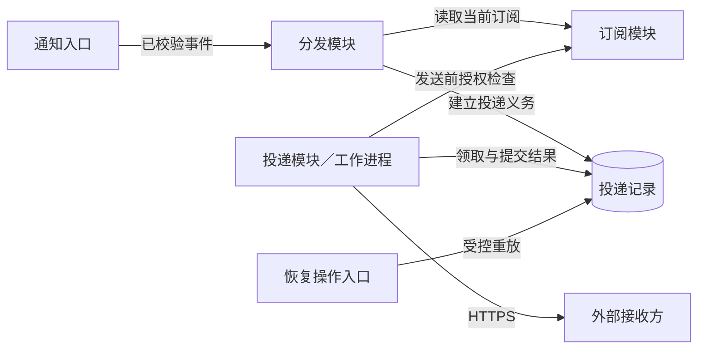

# 海岚公司通知子系统架构设计

**用途：** 供开发和维护人员长期维护的具体架构设计。  
**状态：** 草案；已知行为与待评审设计并列说明，未证明实现或验证完成。  
**依据：** 仅使用所供《完整文档评估材料：通知子系统》的稳定系统事实。该材料是合成案例，没有代码、实测数据或验收结论。下文“已知”指案例给出的事实，“建议”指本设计补充的机制。

## 1. 职责、范围与父系统约束

通知子系统属于海岚公司已登记的业务协作系统，消息组负责开发、维护和投递恢复；业务平台组负责父系统，并拥有业务后端的状态与查询恢复职责。子系统把业务变更通知送给当前有权接收的接收方。业务状态是否改变、如何改变，始终由业务后端决定。

通知需要独立维护订阅、每个接收方的投递进度以及跨进程失败恢复。这些职责共同支撑一个外部保证：业务变更发生后，通知能够在允许重复和乱序的环境中持续推进，且不会把重复事件变成新的业务操作。其复杂度值得作为父系统内的子系统维护，但不意味着它必须独立部署或成为新的登记系统。

典型场景是某租户的对象发生变更：后端增加对象修订号，通知子系统提示授权接收方发生了变化，接收方再查询最新状态。通知不是状态快照，也不能作为业务完成的证据。因此，本设计优先保障租户隔离、状态不丢失及失败可追查；吞吐、延迟和可用性目标尚无给定数值，不能据此宣称满足生产容量。

父系统已经约束了状态与事件同事务写入、重复和乱序的队列语义、发送前重新检查订阅授权。消息组可以细化投递事务、租约隔离和重试策略。改变事件含义、业务查询权限或接收方对确认响应的理解，则需要与业务平台组及接收方共同确认。材料未提供父系统架构或接口定义的实际路径，此处不虚构权威链接。

## 2. 外部协作与关键保证

业务后端每次变更都在同一数据库事务中保存真实状态和待发送事件。事件包含租户、对象标识、修订号、事件标识和发生时间，不含完整敏感业务内容。转发器负责把待发送事件投递到现有队列，然后标记发送结果；若在两步之间崩溃，同一事件可能再次进入队列。

通知入口检查调用方服务身份和租户范围。建议将队列消费也视为一次受控入口：队列访问身份不能替代事件租户校验，来源身份与租户不一致的事件不得进入分发。入口的成功只应表示事件已被可靠接纳，不能表示接收方已收到；具体接纳事务见第4节。

图中业务后端与转发器是上游协作者，队列是基础设施；接收方位于通知子系统之外。箭头表达交互方向，不表示这些参与者拥有相同信任权限。

工作进程向登记的 HTTPS 地址发送通知。收到约定的确认响应，只说明对端收到通知，不说明业务已处理。请求超时则无法判断对端是否收到，必须保留结果未知的含义。确认响应的具体协议尚未提供，实施时需由消息组与接收方约定成功、可重试和不可重试响应的识别规则。

接收方收到通知后，检查对象修订号，旧修订通知可以忽略；发现新修订号时，使用自己的身份向业务后端查询最新状态。通知提示变化，状态以查询结果为准。材料没有描述接收方内部如何写入或并发更新状态，本设计也不据此承诺接收方内部一定完成一致性收敛。

上述协作不提供端到端恰好一次处理：事件可能重复，投递也可能重复。通知子系统负责避免重复生成独立投递义务，接收方负责不把重复提示解释为新的业务操作。查询不可用时，消息组无法通过把通知标为成功恢复业务查询；该依赖由业务平台组恢复。

## 3. 内部方案与职责边界

内部围绕订阅、分发和投递三项功能组织。订阅模块维护接收方与对象范围，并提供当前授权判断；分发模块把事件转化为接收方投递记录；投递模块负责发送、重试和恢复。通知入口是接入组件，工作进程是投递功能的运行载体，数据库租约是共享并发机制，均不另立为业务子系统。

分发与投递解耦，使慢接收方的网络响应不阻塞其他接收方的任务建立。每个接收方有独立投递记录，一个接收方失败不会把同事件的其他记录退回。代价是需要持久化更多记录、维护重试调度并监测数据库压力。把所有接收方放在一次同步调用中虽然较简单，却会让部分成功难以恢复，不适合材料给出的重复和超时条件。

建议复用现有关系数据库执行唯一约束、短事务和租约条件更新，复用现有队列缓冲输入。增加新的调度基础设施目前没有事实依据。工作进程扩容只增加并行处理能力；若数据库领取竞争或下游容量成为瓶颈，应以测量结果调整批量、并发和隔离方式，不能认为实例数增加必然提高整体吞吐。

订阅授权必须由订阅模块的当前状态判定。分发时选中过某个接收方，仅表示当时生成了候选投递；不能永久授予发送资格。建议登记 HTTPS 地址时检查目标归属与允许的出站范围，实际发送禁止未经校验的重定向，避免登记地址绕过租户和网络边界。这是安全补充方案，地址准入规则及运行平台提供的出站控制能力需要验证。

## 4. 数据与状态设计

业务对象以租户和对象标识定位，修订号只在该对象内比较。事件标识用于识别一次变化；投递记录以事件和接收方为唯一组合。实施时必须明确事件标识是否全局唯一；在此之前，建议所有查找、唯一约束与审计关联都携带租户，防止跨租户标识碰撞。

建议增加一个持久化的事件接纳记录，用于记录事件是否已经完成分发。在一次本地事务内，分发模块读取一致的当前订阅集合，插入该事件的全部投递记录，并标记分发完成；提交成功后才确认队列消息。唯一约束使队列重复消息返回既有结果。若进程在提交后、队列确认前退出，再次消费不重新选择后来新增的订阅，而是识别已完成分发。这样一次事件的接收方集合有明确生成时点，历史事件是否向新订阅补发须另行制定政策。

这一事务建议适合接收方数量可由单次事务处理的情形。材料没有规模数据；若扇出规模过大，应先设计持久化接收方快照和分批完成标记，再调整事务边界。不能只把队列消息提前确认后交给内存继续分发。

投递记录的已知状态及建议转换如下：

| 当前状态 | 触发条件 | 后续状态 |
| --- | --- | --- |
| 待发送、待重试 | 到期且成功取得租约 | 发送中 |
| 发送中 | 当前持有者得到有效确认 | 已确认 |
| 发送中 | 暂时失败或结果未知，尚可重试 | 待重试 |
| 发送中 | 重试达到上限或需人工判定 | 人工处理 |
| 发送中 | 租约过期并被重新领取 | 发送中，产生新租约代次 |
| 人工处理 | 经授权批准重放 | 待重试 |

尝试次数、下次尝试时间和错误分类是既有记录内容。建议每次实际发送前先持久化一次尝试，记录租约代次和授权检查结果；该设计可能把“登记尝试后尚未发出即崩溃”计入次数，但比遗漏一次可能已发生的发送更易追查。具体计数政策、重试上限及退避参数待消息组确定。

租约隔离建议采用单调递增的领取代次。数据库领取记录时原子地写入持有者、到期时间和新代次；续租、提交确认或失败结果均须同时匹配当前代次、持有者及有效期限，并以数据库时间判断是否过期。旧工作进程的条件更新影响零条记录时，必须丢弃其提交结果，不得无条件覆盖。该机制保护数据库中的最终结果，不能撤销已经发出的 HTTPS 请求。

订阅撤销不应伪装成“已确认”。建议把被撤销授权的未发送任务置为人工处理，错误分类记为授权撤销，自动调度不再领取；恢复授权也不自动重放历史记录。这样保留材料给定的五种状态，同时由人工决定历史义务是否仍成立。长期积累较大时可以评估增加独立的停止投递状态，但那是需评审的数据模型变更。

业务后端的待发送事件是上游恢复来源；事件接纳和投递记录则是通知恢复依据。业务最新状态不能重建所有历史事件及其投递结果，因此不得在没有保留与对账方案时删除这些记录。人工重放审计记录操作者、对象、原因、时间和结果，不存通知正文；审计保留期限和投递记录保留期限均需制定。

## 5. 关键流程与实现机制

以下为设计推演，不是实测记录。设某租户的对象从修订10变为11，产生事件甲。

1. 业务后端在同一事务中提交修订11和事件甲；事务回滚则两者都不生效。转发器读到待发送事件，将其送入队列，随后记录发送结果。
2. 入口验证来源和租户，分发模块按第4节的事务建立事件甲对应的各接收方记录。重复事件只返回既有接纳结果。
3. 工作进程领取其中一个记录，取得租约代次，再向订阅模块确认该租户、对象和接收方当前仍获授权。授权不明时暂停本次发送；明确撤销时进入受控停止处理。
4. 建议让订阅撤销和发送许可签发在同一授权状态上串行化：撤销提交后不得签发新的许可；许可仅适用于该次尝试。许可签发应紧邻实际发送，工作进程暂停或租约变化后必须重新检查。已开始的网络请求可能在撤销后到达，无法撤回；若要求撤销完成时连尚未发出的已许可请求也不得继续，需要出站执行层参与失效控制并单独验证。
5. 工作进程发出通知，对端返回有效确认后，以当前租约条件把记录更新为已确认。接收方发现修订11后自行查询业务后端；如果修订12已先发生，查询得到的应是后端当时可见的最新状态，通知不要求对端先重放修订11的业务动作。

一个关键失败发生在第5步：对端已收到请求，但响应在网络中丢失。工作进程无法证明成功，记录应保留未知结果并进入重试。再次投递可能产生重复提示，但仍使用原事件身份，不能生成新的业务变化。若进程恰在超时前退出，租约到期后其他进程重新领取；旧进程恢复后即使拿到迟到确认，也无法覆盖新代次结果。

另一个失败发生在上游：转发器已投递队列，却未能标记结果。它重启后再次投递相同事件，分发事务的唯一约束将重复输入归并到原记录。两个失败分别由不同机制处理：事件身份与本地事务避免重复建立义务，租约代次防止陈旧结果写入，接收方的重复处理约定承担外部请求仍可能重复的后果。

## 6. 部署、运行与失败恢复

已知通知入口、转发器和工作进程均运行在现有应用平台，投递记录保存在现有关系数据库，队列也是已有设施。逻辑模块无需逐一拆成部署单元。建议初期保留入口与分发的紧密部署，使接纳事务易于维护，工作进程独立扩缩容以适应出站负载；实际实例、区域、网络拓扑和高可用方式没有提供，不能据此主张已隔离所有故障域。

数据库不可用时，分发不能可靠落账，工作进程也不能取得或更新租约，因此应停止推进，保留队列消息等待恢复。队列不可用时，转发器保留待发送记录；已落入投递表的记录可在数据库和授权依赖正常时继续处理。授权读取不可用时应暂停发送，而不是使用无法确认有效的旧缓存。接收方不可用则按错误分类退避重试，达到上限转人工处理。任何依赖故障都不能通过写入已确认来消除积压。

消息组需要同时观察队列与投递表中的积压、最老记录年龄、未知结果、重试次数及人工处理量。建议按租户与接收方细分这些信号，区分单个下游故障和整体处理不足；已确认量表示收到通知的进展，不能替代业务处理完成率。告警阈值和容量预算须由实际负载与恢复要求确定，目前均未验证。

人工恢复从记录身份和错误原因开始。消息组先确认依赖已恢复，再校验操作者租户范围、当前订阅授权与重放原因，持久化审计后释放原记录进入重试。建议审计意图与状态修改处于同一本地事务，结果后续追加，避免“操作已执行但无审计”的空档。重放保留原事件与接收方身份，不通过复制为新事件绕开唯一约束。业务查询异常则交由业务平台组处理，接收方应用负责人负责其查询和重复通知处理逻辑。

## 7. 验证与待决问题

验证必须观察完整链路中的持久化结果，而不只检查工作进程日志。以下为计划中的通过条件，尚无已执行证据。

| 要验证的保证 | 场景及判据 | 负责范围 |
| --- | --- | --- |
| 状态与事件一致 | 在后端事务前后注入失败；不存在已提交状态却无对应待发送事件 | 业务平台组 |
| 重复输入不重复建义务 | 在分发提交后、队列确认前崩溃；恢复后每个事件与接收方仅一条投递记录 | 消息组 |
| 旧进程不能覆盖新结果 | 租约到期、重新领取后提交旧代次成功与失败结果；两者均被拒绝 | 消息组 |
| 超时不伪造成功 | 对端收到后丢弃响应；记录为未知或重试，重放仍携带原事件身份 | 消息组、接收方 |
| 授权与租户隔离 | 注入跨租户事件、撤销订阅及授权依赖故障；不得产生未经许可的新发送 | 消息组 |
| 乱序符合合同 | 先发新修订、再发旧修订；接收方不把旧通知当作新业务操作，并按自身身份查询 | 接收方、业务平台组 |
| 可恢复且可审计 | 故障后恢复、达到重试上限及人工重放；记录不丢失，审计可关联每次操作 | 消息组 |

事件标识唯一性、确认响应规则、分发扇出规模、租约时长、重试上限和审计保留期限均待确定。它们分别影响唯一约束、成功判定、事务可行性、恢复速度、人工负担和可追查范围。消息组应给出机制与负载验证，业务平台组确认事件合同；接收方确认重复与乱序的处理能力。

剩余风险包括授权检查与网络发送之间的竞争、未知结果引起的重复，以及数据库成为扩容瓶颈。前两项不能靠“租约有效”一句话消除；应以第5节定义的授权生效边界和对端重复处理实验检验。没有吞吐和延迟目标、故障演练和实现证据前，本设计只能作为可评审的方案，不能作为生产就绪结论。

## 8. 演进与兼容迁移

增加工作进程或替换数据库访问实现，只要保持记录唯一性、领取代次检查和当前授权校验，可作为子系统内部演进。改变事件身份、修订号意义、确认语义或订阅生效时点则会影响上下游合同，需要父系统与接收方参与评审。

对于本设计新增的事件接纳记录和租约代次，建议先以兼容方式增加存储，再部署能读取旧记录的新代码；待历史记录初始化和对账完成后，才启用新的领取隔离。不能让不检查代次的旧工作进程与新进程同时写同一批记录。升级时应停止旧进程领取，处理在途尝试和未知结果，确认旧写入路径退出后再开放新领取。

数据库中已有新代次语义后，直接回退到不检查代次的二进制会破坏隔离保证。可回退版本必须继续识别这些记录与条件更新；否则应暂停投递、保留积压并向前修复。对外已经发出的通知无法撤回，只能保留结果未知并依既有身份恢复。

该稳定设计没有承诺某个项目上线或切换。未来项目若修改外部合同，应以项目证据提出变更，待业务平台组与消息组确认责任范围、验证关键机制后，才把接受的结论纳入长期架构。出现授权越界、无法对账的事件、旧进程覆盖或持续积压时，应重新评审相关机制，而非只提高重试次数。
