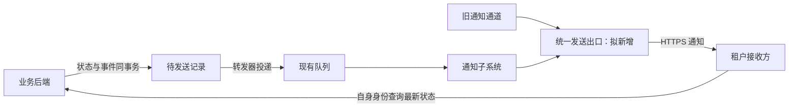
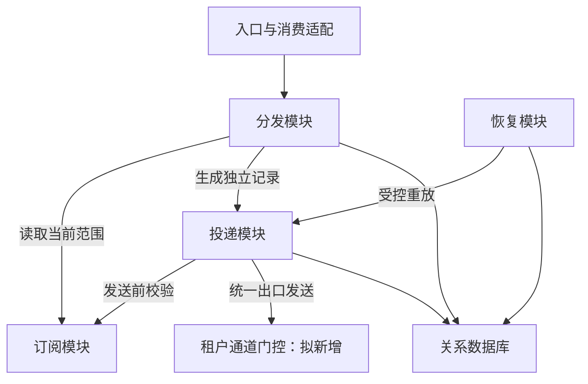

# 多接收方通知改造——通知子系统交付架构

**用途：**具体项目设计，供开发和实施人员评审、实现与验证。  
**状态：**提案草案，未批准、未证实已实现、未通过验收。  
**证据基线：**仅使用本次提供的 `source.md`。这是合成案例，文中“现状”均指案例内给定事实。材料没有提供父系统架构文件、代码、运行数据或验收结果。除明确说明的现状外，下文的门控、隔离、迁移台账及验证安排均为新增设计提案，不能作为长期维护架构的已接受事实。

## 1. 职责、范围与父系统约束

本项目把试点租户从每个对象只有一个接收方的旧通道，迁移到支持多个接收方的通知子系统。改造保留业务后端对对象真实状态的所有权：通知只告诉授权接收方“对象发生了变化”，不能据此执行业务变更，也不能把重复通知解释成第二次业务操作。

通知子系统属于已登记的业务协作系统。业务平台组负责父系统以及对象状态、修订号和事件；消息组负责子系统的订阅、投递和恢复。通知接收、订阅授权、异步分发及投递恢复共享一组长期不变量，且需要协调重复、乱序和独立接收方的失败，因此作为子系统维护具有实际价值。本项目不把工作进程、队列或数据库另立为子系统。

开发人员需要实现多接收方投递和安全的运行机制，实施人员需要判断何时可以切换、何时必须停止，以及如何保留每个未完成通知的恢复责任。试点租户的应用负责人负责确认各自接收方可处理重复通知；项目负责人和验收负责人的姓名未提供，也没有上线日期或批准记录。

代表性场景是一个对象修订后，两个当前授权接收方分别得到通知；其中一个及时确认，另一个超时后重试。即使在这一过程中切换或回退，第一次确认不能代替第二个接收方的完成，超时也不能当成未发送或成功。切换期间撤销订阅仍须阻止后续发送。

已给定的运行约束是沿用现有应用运行平台、关系数据库和队列。工作进程可扩容，队列允许重复和乱序，没有给定吞吐、延迟或可用性指标。设计优先维护授权、状态所有权和可恢复性；容量目标需要测量与确认，不能以固定数字假装已达标。

## 2. 外部协作与关键保证

业务后端在同一数据库事务内更新对象状态、增加修订号并写待发送事件。事件含租户、对象标识、修订号、事件标识和发生时间，不含完整敏感业务内容。转发器向现有队列投递后标记结果，崩溃可能造成重发。这是通知流程的起点，通知子系统不跨数据库替业务后端完成事务。

下图表达外部关系。箭头表示消息或查询方向；旧、新通道都受本项目拟新增的统一出口控制约束，不表示两个通道同时向外发送。

通知入口校验调用方的服务身份和租户范围。通过校验只证明本次调用可以进入该租户的通知处理，不证明所有接收方均被授权，也不证明投递完成。入口拒绝跨租户请求；授权依赖不可用时暂停相关处理，不能绕过验证。

队列消费与接收方调用均为异步过程。拟将队列消费成功定义为事件及其分发结果已持久化，不以网络请求已开始作为成功条件。接收方的 HTTPS 确认只表示对端收到通知，不表示业务处理成功。连接中断、超时或确认后本地提交失败都可能留下未知结果，恢复时允许再次通知。

接收方看到新修订号后，以自己的身份查询业务后端的最新状态；旧修订通知可以忽略。修订号帮助接收方判断是否需要重新查询，真实业务状态仍以查询结果为准。材料未规定接收方内部如何比较、保存或并发更新本地状态，本项目也不把任何内部算法列为现状。应用负责人需提供重复、乱序及查询失败后恢复的验证证据。

业务平台组负责查询服务故障的恢复，消息组负责投递恢复。通知确认后接收方查询失败，不能通过把投递记录改成失败来宣称已完成端到端业务恢复；两个责任域应分别观察、定位和恢复。

## 3. 内部方案与职责边界

拟保留订阅管理、分发、投递和恢复四项功能。订阅管理决定当前接收方与对象范围及其授权关系；分发根据当前订阅生成事件与接收方的投递记录；投递执行发送及结果记录；恢复负责重试、人工处理和经授权的重放。四项功能都不拥有业务对象状态。

图中模块是软件职责，数据库和门控是共用机制，不构成更多功能层级。入口与转发器沿用现有应用运行平台；投递模块由可扩容工作进程承载。订阅读取、投递持久化和恢复操作通过本地模块及数据库适配实现；接收方 HTTPS 调用和业务后端查询跨远程边界。具体模块是否同进程部署由实现决定，本设计没有新增独立部署的必要假设。

项目新增租户通道门控，负责唯一活动通道、切换状态、发送世代及在途尝试登记。它必须处于旧、新通道共同使用的最终发送出口，旧通道不允许保留可以绕过该出口的直连路径。仅在调度器中设置一个开关不足以阻止已经领取任务的旧工作进程继续发出请求。

这里选择在现有关系数据库保存门控和迁移记录，便于用事务协调状态并检查并发修改。代价是发送前增加同步控制路径，数据库不可用会使两条通道都停止发送。若实测门控竞争限制容量，应先测量每租户竞争情况再调整粒度；不能以缓存的旧许可提升吞吐而破坏通道互斥。

本项目沿用材料中的“状态与事件同事务”“至少一次投递”“每个接收方独立恢复”机制，新增版本隔离与出口控制以适应切换。没有提供外部参考知识，因此不存在可声称已经采纳的外部标准或参考实现。相较于同时双发再由接收方去重，本方案符合单活动通道约束；相较于先清空积压再切换，它保留完整恢复依据。代价是切换时允许暂时停发，且必须实现逐项核对。

## 4. 数据与状态设计

业务对象的租户、对象标识和修订号由业务后端解释。事件标识用于识别同一次变更，接收方标识用于区分独立投递目标。拟在存储键中明确租户作用域，避免假定事件标识在所有租户间天然全局唯一；事件和接收方的唯一组合约束应在该明确作用域内生效。

通知侧拟保存最小事件账本、分发完成标记和投递记录。首次消费时，在同一通知数据库事务中登记事件，读取一致的订阅版本，创建当时匹配的接收方记录并标记分发完成。重复消费看到已完成分发，只核对已有结果，不因后来新加订阅而给旧事件重新扩大接收方集合。若一次事务无法承载未来的大批量分发，需另行设计带确定接收方集合的分批提交；本项目不把未实现的分批可靠性当成保证。

每条投递记录保留待发送、发送中、已确认、待重试、人工处理五种给定状态，并记录尝试次数、下次尝试时间和错误分类。拟补充租约持有者、到期时间和单调增加的领取版本。工作进程在事务中领取到期任务并增加版本；只有版本、持有者及有效租约都匹配的工作进程，才可提交结果或续租。租约过期可重新领取，迟到进程的成功或失败写入必须被拒绝，不能覆盖新持有者的结论。

合法的主要路径是待发送或到期的待重试进入发送中，收到确认后进入已确认，可恢复错误或未知结果进入待重试，达到尚待确定的重试上限进入人工处理。人工重放经权限检查后使同一记录重新可调度，并保留原尝试历史，而不是制造一个新事件。授权撤销不是“已确认”：拟保留不可发送标志与撤销原因，将尚未完成记录归入人工处理但禁止自动重试，供审计区分被撤销的义务与故障积压。重新授权不自动恢复历史投递，须明确重放范围。

拟保存迁移台账，将旧配置、导入订阅、事件与接收方组合以及旧、新通道尝试关联起来。台账记录已确认、未开始、在途未知及已撤销等核对结论，这些是迁移解释，不替代投递状态。导入需幂等，不覆盖导入之后的订阅撤销或租户主动修改。消息组维护映射，试点应用负责人确认接收方身份与地址对应正确。

事件接收和投递记录可以使用通知侧事务，业务后端事务、队列交付和远程 HTTPS 调用之间没有共同事务。无法原子地同时记录本地完成和证明远端接收，因此任何“恰好一次”声明均不成立。拟保留事件账本和迁移记录至核对与恢复完成；具体保留期限由责任人确定，不能提前删除唯一恢复来源。

人工重放记录操作者、对象、原因、时间和结果，不保存通知正文。重放检查当前租户范围与订阅授权；审计保留期限尚未确定。切换和回退同样拟记录执行身份、租户、前后通道状态、世代及核对证据，形成可追溯的控制变更。

## 5. 关键流程与实现机制

以下以对象从修订 11 更新为 12 为说明性例子，数字不代表实际运行记录。业务后端提交状态与事件后，转发器可能投递同一事件两次。通知入口校验身份与租户，分发模块通过唯一约束只建立一组分发结果；若当前授权接收方为甲、乙，则分别生成两条记录。

工作进程领取甲的记录并得到新的领取版本，随后在最终出口检查租约版本、租户活动通道和当前订阅授权。检查通过后登记在途尝试并发出 HTTPS 请求。甲确认后，工作进程凭原版本把记录改为已确认；乙超时则保留未知结果并进入待重试。甲的确认不改变乙的记录，也不能使整个事件成为“全部业务已处理”。

如果发送后工作进程崩溃，租约过期后其他进程可以重新领取。新进程不知道远端是否已收到，因此重复发送是允许的；旧进程迟到回写会因领取版本不匹配失败。此隔离保护本地状态，不能撤回旧进程已经发出的通知。接收方必须能接受这样的重复，并从业务后端查询最新状态。

发送前授权检查必须与撤销建立明确先后关系。拟让订阅撤销和出口取得发送许可使用同一租户、订阅范围的序列化控制：撤销先提交，则后续许可被拒绝；许可先取得且请求已交给出口，则该次为在途请求，撤销阻止其后所有新尝试。不能承诺撤回已进入网络的通知。取得许可后尚未发出的请求须在出口再次检查撤销与门控世代，避免把长期缓存的许可当成永久授权。

租户门控与数据库领取版本解决不同问题。领取版本阻止陈旧工作进程修改记录，通道世代阻止旧批次继续获得外发资格。出口需持有可撤销的执行资格，不能仅由工作进程自行声称世代有效。切换先关闭出口接收新尝试，再处理已登记在途调用，最终确认旧出口执行者已经停止或被平台隔离后，才能打开新通道。仅等待数据库租约到期不能证明一个暂停后恢复的旧进程不会发送。

该设计要求运行平台提供可验证的出口隔离能力，例如终止旧执行者并确认失去外联能力；材料未提供这种能力的证据。若实现不能证明旧出口已失去发送能力，切换必须停在关闭状态，不能冒险启用另一条通道。远端可能在旧请求已离开本地后才收到它，这不等于本地仍在启动旧通道发送，也说明未知结果必须持续保留。

## 6. 部署、运行与失败恢复

入口、转发器和工作进程运行于现有应用平台，通知记录保存在现有关系数据库，队列为已有依赖。拟新增的门控逻辑与最终出口可以作为既有应用中的模块部署，无需假定新的网关产品。关键部署验收是两条通道均经过同一控制协议，且没有旁路。

扩容增加领取和发送能力，但数据库锁竞争、队列到达率及接收方处理能力仍可能成为限制。拟为每租户和每接收方提供并发约束及退避重试，具体限值通过试点压测和双方容量确认决定。一个接收方持续失败不应阻止同一事件对其他接收方的独立恢复；也不应以无限重试耗尽数据库和工作进程。

数据库不可用时停止领取、授权判断及切换，不能把未落库的远端确认直接视为可靠完成。数据库恢复后从记录重建调度，对远端可能已接收的尝试保留重复风险。队列不可用时业务后端的待发送记录继续作为转发恢复来源，转发器不能伪造发送成功。工作进程重启从租约与到期时间恢复，不依赖进程内存保存唯一进度。

运行观察覆盖待发送积压、最老记录年龄、未知结果、重试和人工处理量，并按租户、接收方及通道区分。迁移期额外观察门控状态、在途尝试数、未核对事件数和被撤销而禁止发送的记录。最老年龄与未知结果持续增长，是恢复流程需要介入的证据，不能只看成功请求率。

消息组处理订阅、投递和迁移台账故障，业务平台组恢复状态查询与事件来源，应用负责人处理接收方兼容问题。重放之前先确定租户、事件、接收方及当前授权，记录原因，再通过当前活动出口重新调度。重放不清空历史失败，也不把查询故障误判为通知丢失。

依赖失败时允许积压，但没有证据支持“无限积压也不会丢失”的承诺。磁盘、保留策略和恢复窗口需在试点前确认；若队列或源记录会在恢复完成前过期，必须先补足持久化和核对方案。

## 7. 验证与未决事项

当前全部验证均为计划，没有已执行或已通过的结果。以下通过条件来自项目不变量或本提案机制，不使用材料中不存在的性能阈值。

| 要验证的保证 | 场景与检查 | 所需证据与责任 |
| --- | --- | --- |
| 状态变更可恢复地产生通知 | 在业务事务、队列投递及标记之间分别注入崩溃；核对已提交事件均可重新发现 | 事务与恢复记录；业务平台组 |
| 重复不扩大发送义务 | 重复消费、乱序消费及消费后新增订阅；检查唯一组合和首次分发集合 | 数据核对与消费日志；消息组 |
| 旧持有者不覆盖新结果 | 暂停旧进程、等待租约到期并重新领取，再恢复旧进程回写 | 被拒绝的陈旧版本写入；消息组 |
| 超时不伪装成功 | 对端接收但不回包，以及确认后本地提交失败 | 未知结果、再次通知及接收方行为证据；消息组、应用负责人 |
| 撤销持续生效 | 在领取前、许可前、在途及切换中撤销 | 撤销提交后无新授权发送，已有在途可追溯；消息组 |
| 单租户只有一个发送通道 | 关闭期间恢复暂停的旧进程，并尝试启用新通道 | 无旁路、出口隔离及世代拒绝证据；消息组、平台能力提供方 |
| 积压无遗漏 | 同时准备源待发送、队列和投递表积压；切换及回退后逐项核对 | 每个应投递组合有已确认、待恢复或合法撤销解释；消息组、业务平台组 |
| 多接收方回退有去向 | 给额外接收方保留失败和未知记录，再触发回退 | 没有因旧配置缺少接收方而删除义务；消息组、应用负责人 |
| 恢复动作可授权和追溯 | 跨租户重放、无权操作、正常重放和审计查询 | 拒绝证据与不含正文的审计记录；消息组 |

试点前需要消息组明确重试上限、退避与并发策略，并以故障注入和容量试验支撑；业务平台组确认源事件可检索范围与保留条件；应用负责人提交重复、乱序、最新状态查询和查询故障恢复的兼容证据。审计及迁移记录保留期限需要相应管理责任人决定，该责任人的身份未提供。

旧通道的可暂停性、发送历史可核对性、旧接收方通知契约及运行平台的出口隔离能力均未在材料中给出。它们分别影响互斥切换、无遗漏核对、旧接收方兼容和陈旧进程阻断。应由业务平台组和消息组共同调查；不能将假设写成已具备能力。

项目负责人及验收负责人需被指定，随后确认切换门槛与证据。没有这些证据和责任承接，不应宣布可上线。即使技术检查通过，网络未知结果及已发通知无法撤回的风险仍然存在，必须由接收方兼容和持续核对承担。

## 8. 演进与兼容迁移

### 导入与影子阶段

旧配置导入时保留租户、对象范围、接收方身份与登记地址的对应关系，建立可重复执行的映射。先仅导入旧接收方，再由租户确认新增接收方及其授权，避免把历史配置迁移等同于任意新增授权。旧配置的变更与新订阅的撤销需进入同一受控迁移记录，不能在第二次导入时把已撤销关系重新启用。

影子阶段只验证事件接收、分发集合和拟生成的投递记录，最终出口拒绝新通道外发。影子记录使用明确的非发送用途标记，与正式可调度记录隔离；转正式时按迁移台账和当前授权决定是否生成或恢复投递义务，不能把全部历史影子结果直接放开。此时旧通道是唯一活动发送通道。

接口兼容需逐项确认旧接收方能识别对象、修订及事件，并以自身身份查询业务后端；旧通道现有负载格式未提供，因此无法断言完全兼容。若需适配，适配器只能转换通知契约，不能复制敏感状态或代替接收方执行业务变更。旧接收方兼容测试未通过时，不进入正式切换。

### 关闭旧通道与核对

拟采用“旧通道活动 → 全部关闭并核对 → 新通道活动”的租户状态转换。进入关闭状态的事务增加通道世代并拒绝两边的新发送许可。已领取但未开始网络请求的任务退回可恢复状态；已开始的调用登记为在途，等待有界调用结束或被出口取消。超时仍记为未知，不能抹去。

完成在途登记后，确认旧出口执行者已停止或被隔离。只有这个事实得到验证，才具备开启新通道的安全前提。期间业务状态和事件仍可产生，转发与持久化继续，允许积压；控制面故障则保持关闭。

队列为空不能证明迁移完成：源待发送记录可能尚未转发，投递表也可能含已领取或待重试任务。拟以业务后端可检索的源事件、通知事件账本和投递台账逐项核对。切换时建立一份封闭的核对批次，并持续纳入之后的新事件；批次需有可靠的源快照或提交游标，不能用事件发生时间或全局最大修订号猜测完整边界，因为修订号按对象递增且队列乱序。源快照或游标能力需要业务平台组实现或证实，否则无遗漏切换条件尚不满足。

对旧通道已确认的原接收方组合保留完成证据；对未发送或未知的组合导入新通道恢复集合；不确定旧结果时允许重复，不允许跳过。新增接收方的起始生效范围由订阅建立时的明确批次边界确定，不默认补发全部历史。每个应投递组合都必须落在“有确认”“可恢复未完成”或“当前已撤销并留痕”之一，才算核对闭合。

### 启用新通道

启用事务将租户活动通道改为新通道，并生成新世代。工作进程重新读取门控与当前授权后领取可发送任务，不能沿用影子阶段或关闭前的许可。消息组观察积压年龄、未知结果及核对差异，应用负责人确认实际接收与查询行为。试点批次大小、观察时长及告警阈值须依据验证结果确定，本文不编造数值。

若订阅在关闭期间撤销，新通道启用也不恢复该接收方发送。变更接收方地址需经过订阅管理校验，投递恢复不能私自使用历史地址绕过当前授权。

### 回退与不可逆限制

回退同样先将全部出口关闭，增加世代，登记新通道在途结果并隔离旧执行者，再核对源、队列和投递表；不能通过简单切换配置同时释放两个通道。已经对外发出的通知无法撤回，未知结果按可能已送达处理，重放必须依赖接收方接受重复。

旧通道每个对象只支持一个接收方，因此软件回退不天然保留多接收方语义。若存在新增接收方的未完成投递，本方案禁止直接退回旧通道并丢弃这些记录。可先保持关闭，将问题修复到最低可恢复的新通道版本，作为唯一活动通道处理额外接收方的积压；完成核对后再次关闭并切回旧通道。若新通道短期无法恢复，保留这些义务并明确停发，不能宣称回退已成功且没有漏发。

要在回退后继续承诺多接收方通知，必须另行使旧路径具备按接收方执行恢复的能力，并经过同一门控和验证。该能力不是案例现状，也不是本次可以默认已具备的回退前提。在能力建立之前，完整回退仅适用于新增接收方义务已完成或被合法撤销、且后续订阅语义可由旧通道承接的租户；不能由项目操作人员为回退方便擅自撤销订阅。

回退结束仍保留新通道投递记录、在途未知记录、导入映射和审计证据，直到所有未完成义务都有明确去向。移除门控、删除旧通道和将本提案写入长期架构，应分别在证据与审批齐备后处理，不以试点成功自动推定全公司适用。
