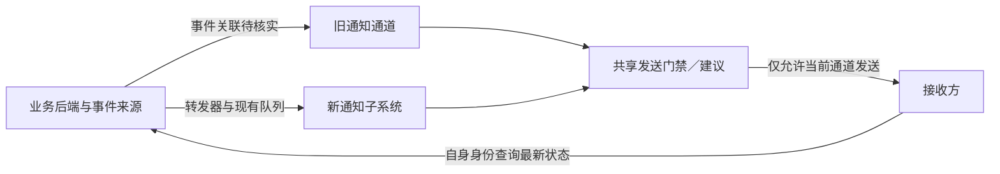
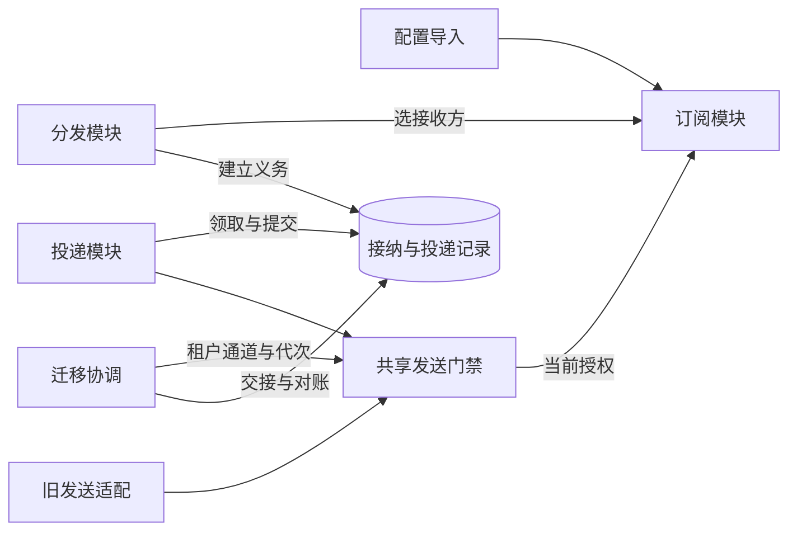
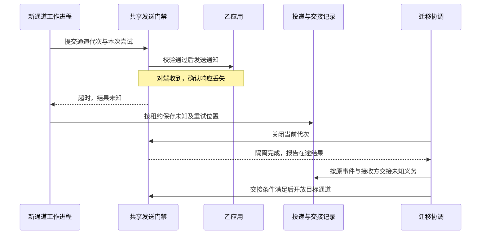

# “多接收方通知改造”项目——通知子系统交付架构

**用途：** 供开发和实施人员评审、实现及验证本次试点迁移。  
**状态：** 目标方案草案；新增机制待评审、实现和验证，尚无上线批准、切换演练或验收结果。  
**依据：** 所供《完整文档评估材料：通知子系统》，为合成案例。案例事实作为约束，下文新增机制均为设计建议。

## 1. 职责、范围与父系统约束

“多接收方通知改造”将试点租户从每个对象仅配置一个接收方的旧通道，迁移到支持多个接收方的通知子系统。交付对象属于海岚公司已登记的业务协作系统。业务平台组继续拥有业务对象状态并负责事件与查询；消息组负责订阅迁移、投递和恢复；试点应用负责人确认各自接收方能正确处理重复通知。

本次交付覆盖新通道内部设计、旧配置导入、影子检查、切换、兼容回退与验证。详细部署命令、完整接口字段表和任务排期不在范围内。长期设计可对照[通知子系统架构草案](stable.md)；两篇均为待评审方案，项目中的迁移协调和发送门禁不因此自动成为已接受的长期架构。

项目必须守住三项约束：同一租户同一时段只允许一个通道实际发起发送；队列及投递表积压均有可恢复去向，不能清空记录掩盖未送达事件；订阅撤销在迁移中持续有效。已经发出的通知无法撤回，回退只能恢复后续投递能力，并依赖接收方处理可能的重复。

例如，某个旧接收方已收到通知但确认丢失，切换不能把它当成未发生过发送，也不能认为它已经完成。方案需要保留未知结果，把同一事件与接收方的义务交给新通道继续处理。新增第二个接收方后，还必须单独追踪第二份义务，不能沿用旧通道的单接收方完成标记。

项目负责人和验收负责人的姓名及批准权限尚待明确。材料也未给出上线日期、吞吐、延迟或可用性目标；这些缺口分别影响交付批准和容量验收，需在真实切换前落实。

## 2. 外部协作与关键保证

业务后端每次变更都增加对象修订号，并在同一数据库事务中保存状态和待发送事件。事件包含租户、对象标识、修订号、事件标识和发生时间，不含完整敏感业务内容。转发器投递队列后才标记发送结果，崩溃可能使其重复投递；已有队列允许重复和乱序。

下图是建议的目标连接方式。旧、新通道都必须通过共享发送门禁，门禁负责在真实出站位置执行租户通道选择。旧通道实际的事件来源及关联能力仍需核实，图中的统一事件关联是迁移要求。

新通知入口校验调用方服务身份与租户范围。建议队列消费也执行来源与事件租户校验。入口接纳成功只表示投递义务已持久化；工作进程向登记的 HTTPS 地址发送通知，确认响应只表示对端收到；业务是否处理完成另由接收方和业务后端判断。超时表示结果未知，不能记为成功。

接收方发现新修订号后，使用自己的身份查询业务后端最新状态；旧修订通知可以忽略，重复事件不可解释为新的业务操作。试点应用负责人需要用各自实际应用验证这些行为。接收方内部保存状态的算法不属于本次通知设计的既定事实。

建议为旧接收方保留兼容格式，通过发送适配层传递相同的事件身份和修订含义。旧格式能否表达这些信息、哪些响应构成有效确认、哪些错误可以重试，都需要逐一核对。若格式变化会改变旧接收方行为，必须先完成兼容验证，不能以“配置已导入”代替迁移成功。

影子新通道可以读取事件、计算接收方和比较结果，但没有真实发送资格。租户切换的单通道约束以真实出站控制为准，不能只依赖工作进程读到的配置。此前已经发出的网络数据可能在切换后才到达对端；控制点能阻止旧通道再发起请求，不能撤回在途数据。

## 3. 内部方案与职责边界

新通道保留三项功能：订阅模块管理接收方、对象范围和当前授权；分发模块为事件建立各接收方的独立投递记录；投递模块执行发送、重试和恢复。工作进程是投递模块的运行载体，数据库租约提供并发控制。

项目新增迁移协调功能，负责导入核对、租户通道状态和投递义务交接。共享发送门禁是旧、新投递执行共同使用的控制组件，不拥有业务状态，也不自行决定切换目标。

每个接收方单独建账，使一个接收方超时不会阻塞另一个接收方的完成。分发和投递因此可以分别扩容，但会增加数据库写入与调度成本。建议继续使用现有关系数据库、队列和运行平台，先以事务、唯一约束和条件更新实现恢复机制；是否需要分批分发或进一步隔离，应由扇出规模与负载试验决定。

### 3.1 订阅迁移只保留一个授权权威

一次全量复制不能覆盖后续撤销。建议先将旧配置写入转为受控入口，记录导入映射及版本；在基线核对和增量应用完成后，把新订阅切为迁移租户的唯一授权权威。旧通道发送也读取这一权威，旧编辑入口不再独立写入。切换写入入口期间，撤销请求应被持久化并先于后续发送判断生效，不能因导入而拒绝或遗失。

导入记录关联旧配置、目标订阅、版本和撤销标记。重复导入只能合并同一映射；较旧快照不得覆盖更新的撤销。这里需要验证旧配置写入能否被约束，以及两条发送路径能否读取当前授权，否则不能开始真实迁移。

### 3.2 在出站处执行通道互斥

建议发送门禁根据租户持久化控制记录检查开放通道和通道代次。工作进程只向门禁提交发送请求，不持有可绕开门禁的真实出站能力。门禁将通道关闭、授权撤销和出站准入串行化，并追踪尚未开始及已经开始的尝试；许可不交给工作进程缓存后自行使用。

仅修改两个开关或停止领取，无法阻止暂停中的旧进程恢复后继续发送。共享门禁增加了一个依赖及其故障恢复成本，却能在最后发送位置拒绝旧代次请求。门禁自身若采用多实例或主备，也必须隔离失联旧实例的出站能力；仅切换数据库中的代次不能收回它已经缓存的许可。具体网络隔离与执行协调机制需用平台能力实现并验证，未证明隔离时保持租户关闭。

项目沿用源材料的事务事件、独立投递记录和修订查询合同，增加门禁、迁移记录与兼容适配以满足切换要求。仅以开关控制双通道的方案不满足暂停恢复场景，因此不作为切换基线。

## 4. 数据与状态设计

### 4.1 新通道的持久化处理状态

对象由租户和对象标识定位，修订号只在同一对象内比较。投递记录以事件与接收方为唯一组合；事件标识是否全局唯一未明确，建议查找和唯一约束均保留租户限定。

建议首次分发在一次本地事务中保存事件接纳结果和选中的接收方集合，插入全部投递记录并标记分发完成，提交后才确认队列消息。重复消息返回既有结果，不因新增订阅而重新扩展历史事件的接收方集合。大量接收方若不适合单次事务，需先补充持久化快照和分批完成机制；不能提前确认队列后仅在内存中继续处理。

投递记录沿用待发送、发送中、已确认、待重试、人工处理五种状态，并保存尝试次数、下次尝试时间和错误分类。到期记录取得租约后进入发送中；有效确认转已确认；暂时失败或超时未知转待重试，达到上限转人工处理；有权重放后回到待重试。明确撤销授权的未完成记录建议转人工处理并标明授权撤销，停止自动调度。重新授权不自动释放历史记录。

建议原子领取时保存持有者、到期时间和递增租约代次。续租、确认及失败结果提交都必须匹配当前持有者、代次和数据库时间下的有效期限。过期后另一进程可以重新领取，旧进程不得覆盖新结果。每次出站尝试先登记再发送；进程在两者之间崩溃可能计入一次未发出的尝试，但不会失去可能已发送的追查依据。过期重新领取也检查尝试预算，避免崩溃循环无限重试。重试上限、计数和退避参数仍待确定。

### 4.2 租户控制与交接记录

租约代次约束投递记录写入，通道代次约束哪条路径可以发起发送，两者不能互相替代。建议将租户控制状态存入现有关系数据库，每次切换以条件更新串行化，并记录操作者、原因和前后代次。

| 租户状态 | 允许的真实发送 | 恢复时的含义 |
| --- | --- | --- |
| 旧通道运行、新通道影子 | 仅旧通道 | 继续核对，不开放新通道 |
| 关闭中 | 不再接纳新出站；隔离已准入尝试 | 继续完成关闭屏障 |
| 已关闭待交接 | 无 | 继续对账及交接 |
| 新通道运行 | 仅新通道 | 按当前代次处理投递 |
| 旧通道兼容恢复 | 仅兼容后的旧通道 | 按完整接收方集合继续投递 |

回退复用“关闭中→已关闭待交接→开放目标通道”的状态转换，并记录目标通道。关闭不是开放另一条路径的自动触发器；协调器重启后只能从持久化状态继续，不能自行猜测上次切换是否完成。

建议交接记录保存租户、事件、接收方、来源通道、已知确认、未知结果、停止原因和交接去向。已确认只属于对应接收方；授权撤销的记录有停止依据，不能被交接为待发送。影子结果与真实投递记录隔离，影子计算完成不得抑制未来真实义务。

队列与数据库之间不假设分布式事务。交接重复消费按原身份归并，未知结果保留并允许重复发送。上游事件、旧发送证据和迁移记录必须覆盖交接与回退窗口，清理前完成对账。业务最新状态不足以重建这些历史证据；具体保留期限仍需确定。

## 5. 关键流程与实现机制

以下推演新通道已经开放、两个接收方均已授权时的目标行为。某试点租户的对象产生修订11的事件甲，旧接收方为甲应用，新增接收方为乙应用。

业务后端原子提交状态和事件，转发器送入队列。新入口校验身份与租户后，分发事务分别为甲、乙建立记录。工作进程领取甲的记录后，将当前租约、通道代次和接收方身份交给门禁；门禁确认当前通道及订阅授权，登记本次尝试后才发出 HTTPS 请求。若甲确认收到，工作进程按当前租约提交已确认。甲随后以自身身份查询最新业务状态，甲的确认不改变乙的投递记录。

门禁必须区分“已准入但未开始”和“已开始”两类尝试。关闭或撤销后，前者失效，执行组件暂停恢复时也要重新检查；后者可能已经离开本地，后续无法撤回。门禁只有在未开始尝试被阻断、旧执行实例不能继续出站后，才能报告关闭屏障完成。数据库或授权状态不可确认时，保留任务并停止新增出站。

下图聚焦乙应用收到请求但确认丢失，以及随后回退时的处理；不是演练结果。

如果分发事务提交后、队列确认前崩溃，再次消费只能命中已有的甲、乙记录。如果 HTTPS 发出后、结果提交前崩溃，恢复进程仍按未知处理，可能再发一次。租约过期后，旧进程迟到的确认、失败和续租均须被拒绝；通道已经切换时，旧进程的新发送请求还须被门禁拒绝。前一检查保护投递结果，后一检查保护真实发送路径。

影子阶段执行同样的事件解析和接收方选择，但只保存隔离的比对结果，不能创建已确认的真实任务。影子到正式运行的交接如何区分已完成和未完成义务，由第8节的对账决定。

## 6. 部署、运行与失败恢复

通知入口、转发器和工作进程使用现有应用运行平台，队列和关系数据库沿用既有设施。建议将迁移协调及共享门禁作为受控服务能力部署；旧、新发送执行均不得直接访问接收方地址。门禁的旧实例隔离、凭据管理和网络限制需要在平台上验证，实例数和区域拓扑不能代替该验证。

建议登记 HTTPS 地址时检查租户归属及允许的出站范围，实际请求不跟随未经校验的重定向。按租户、接收方限制并发，避免一个故障下游耗尽工作进程。并发上限须由负载和下游能力确定。

数据库故障时停止接纳落账、领取、授权确认和通道切换，队列消息保留；队列故障时转发器保留待发送事件，已持久化任务可在其余依赖正常时继续。门禁或授权依赖故障时暂停出站。依赖不可用不能被计为成功，也不能用删除记录缓解积压。

消息组应观察上游待发送、真实队列及投递表积压、最老记录年龄、未知结果、重试和人工处理量，并独立观察影子差异、门禁拒绝、关闭中在途尝试和未交接义务。门禁关闭后仍出现该通道发起新请求，或对账出现无法解释的缺口，应停止交接并保留证据。业务后端查询恢复仍由业务平台组负责。

人工重放校验操作者的租户范围、当前订阅、当前通道和原因，保留原事件与接收方身份。建议审计意图和释放重试在同一本地事务中提交，结果后续追加。审计记录操作者、对象、原因、时间和结果，不存通知正文；保留期限尚待确定。通道切换同样记录代次、操作者与交接依据，并限制为有权执行该租户迁移的操作。

故障恢复应读取持久化控制状态。处于关闭中时继续隔离，处于已关闭待交接时继续核对；只有确认第8节的开放条件后，才能开放选定通道。门禁重启不得依据旧缓存恢复出站。

## 7. 验证与待决问题

当前没有已通过的验证。下表将主要交付要求对应到设计及可观察的通过条件。

| 要求 | 设计依据 | 必须取得的证据 |
| --- | --- | --- |
| 业务状态仍归后端 | 状态与事件同事务、接收方自主查询 | 事务故障不留下缺少事件的已提交状态；查询使用接收方身份 |
| 多接收方独立恢复 | 每事件、每接收方独立记录 | 一个确认、另一个超时后，仅后者继续；尝试次数及下次时间可恢复 |
| 重复和乱序兼容 | 接纳唯一约束、修订查询合同 | 重复消费不重复建账；接收方不把重复或旧通知当作新业务操作 |
| 旧租约不能污染结果 | 持有者、代次及期限条件更新 | 重新领取后，旧确认、失败与续租全部被拒绝 |
| 单租户单通道出站 | 共享门禁、代次和关闭屏障 | 暂停旧工作进程及旧门禁实例，跨切换恢复它们；旧代次不能再出站 |
| 积压不丢失 | 来源枚举、持久化交接 | 上游、队列、旧发送记录及投递表均有确认、停止依据或可恢复去向 |
| 撤销持续生效 | 一个授权权威、导入版本与出站检查 | 导入旧快照不复活撤销；撤销后未开始尝试被阻断，切换不放宽权限 |
| 影子不干扰真实发送 | 独立输入与隔离结果 | 影子不抢走旧消息、不出站，其处理结果不抑制正式投递 |
| 回退覆盖全部接收方 | 兼容适配继续建立和执行多接收方义务 | 已有未知记录及回退后新事件都覆盖所有仍授权接收方 |
| 恢复可追查 | 租户控制和审计事务 | 无权重放被拒；反复崩溃仍受重试上限约束；合法操作可关联完整审计 |

消息组负责投递、门禁、迁移和恢复验证；业务平台组负责状态事件事务、事件来源完整性及查询验证；试点应用负责人验证接收方的重复处理。项目与验收责任人需明确后才能接受证据并批准切换。

真实切换的主要前提尚待证明：旧通道能够关联事件和接收方；配置修改能转入统一授权；两条通道及失联旧门禁实例都无法绕过出站控制；历史与新增事件可完整枚举；旧通知格式及确认语义兼容。任何一项不成立，都不能以影子运行正常替代切换依据。

租约时长、重试上限、退避、扇出规模、保留期限及性能预算也待确定。消息组应通过负载与恢复实验提出参数，试点应用负责人确认通知延迟需求，再形成验收阈值。剩余风险包括未知导致重复、门禁故障导致暂停，以及旧通道无法承担完整多接收方回退；后者必须在启用新增接收方前解决。

## 8. 演进、切换与兼容回退

### 8.1 导入和影子检查

建议先迁移原接收方，再单独启用新增接收方，使发送路径变化与接收方扩展可以分别核对。消息组按第3节约束配置写入，导入并核对租户、对象范围、地址、版本和授权，追平期间的变更，尤其是撤销。

影子新通道使用独立队列订阅或可靠事件副本，不能与旧消费者争抢同一份待处理消息。已有队列能否提供这种输入需验证。影子结果比较事件覆盖、接收方集合和重复分发，保留差异原因；它只证明计算行为，不能证明真实出站、超时及恢复机制。

进入切换前，应完成接收方格式与重复处理验证，以及进程暂停、门禁失联、超时和重启演练。回退方案必须与即将启用的接收方范围相符。

### 8.2 关闭旧通道，形成可对账的交接集合

协调器先把租户改为关闭中，增加通道代次，拒绝新出站并暂停旧通道领取，新通道保持关闭。门禁阻断已准入但尚未开始的尝试，等待已开始请求完成或达到规定期限，将无法确认送达的结果记为未知。随后验证旧执行实例已失去出站能力，才能进入已关闭待交接。仅等租约超时不足以隔离暂停中的旧进程。

为了在乱序队列中确定交接范围，建议转发前持久化每个事件的路由归属及处理进度。进入交接时暂停该租户新的路由分配，停止并隔离旧转发执行，枚举已分配的事件集合及处理位置。此后业务事务仍可继续写待发送事件；尚未分配的事件保留在上游，待新通道开放后分配。发生时间戳和“队列暂时为空”都不能代替这一边界。

对已分配集合，逐项核对上游发送记录、队列内尚未落账消息、旧发送证据及投递表记录。队列消息先可靠落入接纳或交接记录再确认；已确认的同一事件与接收方义务保留完成证据；未确认及未知义务按原身份交给目标通道；撤销义务保留停止依据。迟到或重复消息再到达时命中同一记录，不形成另一份义务。

迁移开始前的历史数据也要能纳入这个集合。旧通道如果没有可关联的事件身份、接收方或完整恢复来源，需要先补足映射和路由记录。业务平台组负责证明事件来源完整，消息组负责证明每项义务的处理去向。无法枚举历史集合时，不能用抽样或清空队列宣称交接完成。

本方案将原接收方的历史义务与新增接收方的订阅生效分开。正式启用新增接收方时，建议同样短暂停止新事件路由分配，记录新的订阅版本与恢复分配边界；此前事件不因重复消费自动增加接收方。若业务要求补发历史事件，应建立明确的补发范围及记录，不能把影子结果直接当成投递完成。

### 8.3 开放新通道

协调器只有在旧通道出站隔离完成、已分配集合均有明确去向、授权核对完成且新通道具备恢复条件时，才以条件更新开放新通道的新代次。门禁按新状态准入，工作进程处理交接记录；随后恢复上游路由分配，继续处理切换期间新增的待发送事件。

开放失败时仍保持关闭，积压继续持久化。协调器重启后根据控制和交接记录继续，不重置代次或重建事件。未知义务可能导致重复，但不能为减少重复而丢弃没有确认依据的记录。

### 8.4 回退与不可逆边界

回退先关闭新通道，使用同样的隔离和对账屏障，再把未确认、未知且仍授权的义务交给回退路径。新通道已有的确认结果必须保留；已经发出的通知和接收方后续动作无法撤销。

仅迁移原接收方时，旧通道可以承担回退，前提是它已满足事件身份、授权、门禁和对账合同。新增接收方启用后，原来的单接收方配置不足以完整恢复。建议提前为旧发送能力增加兼容适配，使其从每事件、每接收方的独立任务读取目标，而不再从单接收方配置推导唯一目标。适配既要处理交接积压，也要为回退后新产生的事件继续维护全部有效接收方的义务；只交接旧积压仍会漏掉后续通知。

这项旧路径扩展尚未证明可实现，应在开放新增接收方之前验证。若不能支持，默认恢复方式是暂停真实发送、保留所有义务并向前修复新通道。只恢复原接收方意味着其他接收方继续暂停，属于需要项目责任人接受的降级，不能称为完整回退。

可回退的软件版本仍须理解投递租约代次、通道代次、当前授权和迁移后的记录，不能让旧代码绕过新控制。试点结束需满足义务对账无未解释缺口、关键正常与故障场景有证据、回退覆盖与启用范围一致，并为未知和人工处理项明确责任人与处置。项目与验收责任人接受这些证据后，长期保留的机制才进入稳定架构；临时影子与迁移能力则在回退窗口及记录保留政策允许后撤除。
