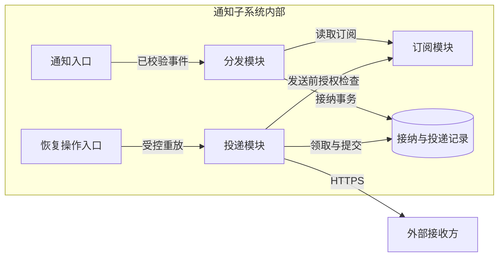
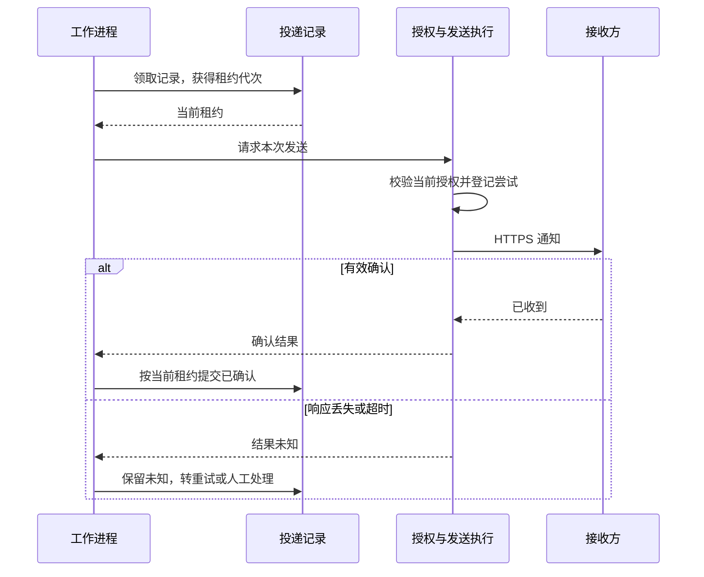

# 海岚公司通知子系统架构设计

**用途：** 通知子系统的长期架构，供开发和维护人员使用。  
**状态：** 设计草案；案例已有约束与新增建议分别说明，新增机制待评审、实现和验证。  
**依据：** 所供《完整文档评估材料：通知子系统》的稳定系统事实。材料为合成案例，未提供代码、实测数据或验收结论。

## 1. 职责、范围与父系统约束

通知子系统把业务变更通知送给授权接收方，是海岚公司已登记的业务协作系统的一部分。消息组负责子系统及投递恢复；业务平台组负责父系统，拥有业务对象的真实状态，并负责业务后端查询恢复。通知子系统不决定或执行业务变更。

订阅关系、各接收方的投递进度和跨进程恢复需要共同维护，因此值得形成一份独立的子系统设计。它们解决的典型问题是：对象状态已改变，但接收方暂时不可用，或通知已经到达而确认响应丢失。子系统必须留下可继续处理的记录，同时允许接收方收到重复提示。这个责任边界不要求每个模块独立部署。

父系统已规定状态与待发送事件同事务写入，队列允许重复和乱序，发送前必须检查当前订阅授权。这些约束优先于处理速度。消息组可以细化分发事务、租约隔离和重试机制；改变事件含义、业务查询权限或通知确认语义，需要业务平台组和接收方共同确认。吞吐、延迟、可用性目标及容量数据尚未给定，性能预算仍需确定。

## 2. 外部协作与关键保证

业务后端每次改变对象状态时增加对象修订号，并在同一数据库事务中写入新状态和待发送事件。事件携带租户、对象标识、修订号、事件标识和发生时间，不包含完整敏感业务内容。转发器把待发送事件投递到现有队列，然后标记发送结果；若在投递后、标记前崩溃，恢复时可能重复投递。

通知入口校验调用方服务身份和租户范围。建议对队列输入同样校验来源权限与事件租户，不能把“有权读队列”等同于“可以代表任意租户”。来源不合法的事件不得分发；处置时应留下受限的错误记录，不能将其计为正常接纳。

入口接纳、通知确认和业务处理是三个完成点。建议仅在第4节的接纳事务提交后报告接纳成功；这时子系统已经保存投递义务，但接收方未必收到。工作进程向接收方登记的 HTTPS 地址发送通知，确认响应仅表示对端收到，不表示业务已处理。请求超时表示结果未知；连接失败、明确拒绝和超时应分别记录。具体哪些响应构成有效确认、哪些错误可重试，仍需消息组与接收方约定。

接收方收到通知后检查修订号，旧修订通知可以忽略；发现新修订号时，使用自己的身份向业务后端查询最新状态。通知负责提示变化，业务状态以查询结果为准。重复事件不可解释为新的业务操作。接收方内部如何保存或并发更新查询结果由其实现决定，本设计不把修订检查扩写为未经证明的内部一致性算法。

这条链路允许重复通知，不承诺端到端只处理一次。通知子系统避免重复建立同一投递义务，接收方则必须正确处理重复提示。业务查询失败由业务平台组负责恢复，不能通过把通知记为已确认来替代查询恢复。

## 3. 内部方案与职责边界

子系统按三项功能组织：订阅模块管理接收方、对象范围和当前授权；分发模块将事件转化为各接收方的投递记录；投递模块执行发送、重试和恢复。通知入口是接入组件，工作进程承载投递模块，发送执行组件在投递模块内完成最后授权检查和出站，数据库租约提供并发控制。下图同时标出持久化记录和外部接收方，以说明这些功能如何协作。

分发不等待接收方的网络响应，而是先保存独立的投递记录。这样，一个接收方确认、另一个超时时，只需继续处理后者。把所有接收方放在一次同步调用中虽然少一层调度，却难以表达部分成功及恢复位置。独立记录的代价是数据库写入量、重试调度和存储维护成本。

建议复用现有关系数据库提供唯一约束、短事务和条件更新，复用现有队列缓冲输入。工作进程可扩容，但数据库领取竞争和下游容量仍可能限制吞吐；出现持续竞争或大规模扇出时，应根据测量结果调整分发批量与并发，而不是仅增加实例。

分发时选中接收方只是建立候选投递，不能成为永久发送资格。订阅模块必须提供发送时的当前授权。作为安全补充，建议接收方地址登记检查租户归属与允许的出站范围，并禁止未经校验的重定向；否则合法订阅可能被用来访问无关地址。地址准入规则和平台出站控制能力仍需验证。

## 4. 数据与状态设计

业务对象由租户和对象标识定位，修订号只在同一对象内比较。事件标识识别一次变化，投递记录以事件和接收方为唯一组合。事件标识是否全局唯一尚未明确，建议所有查找、唯一约束和审计关联都带租户限定，避免跨租户碰撞。

### 4.1 接纳事务与恢复来源

建议增加持久化的事件接纳记录。首次分发时，在一次本地事务内读取一致的当前订阅集合，建立该事件的全部投递记录，并标记分发完成；事务提交后才确认队列消息。重复消费通过唯一约束找到既有接纳结果，不重新选择后来新增的订阅。这样，事件的接收方集合有确定的生成时点；是否向新订阅补发历史事件需要另行决定。

该建议以一次分发能在可接受的事务规模内完成为前提。若实际接收方数量超出这一条件，应先设计持久化接收方快照和分批完成记录，再调整事务边界。队列消息不能在持久化恢复依据建立之前被确认。

后端待发送事件、队列消息及子系统接纳和投递记录分别覆盖链路的不同恢复阶段。业务最新状态不能重建所有历史事件及投递结果，因此记录清理必须受保留和对账政策约束。投递及接纳记录的保留期限尚待制定。

### 4.2 投递状态与租约

投递记录保留尝试次数、下次尝试时间和错误分类。错误分类还应区分明确失败、结果未知与授权撤销，避免恢复时把不同情况当作同一种重试。

| 当前状态 | 条件或动作 | 后续状态 |
| --- | --- | --- |
| 待发送、待重试 | 已到期，原子取得租约 | 发送中 |
| 发送中 | 当前持有者取得有效确认 | 已确认 |
| 发送中 | 暂时失败或结果未知，未达上限 | 待重试 |
| 发送中 | 达到重试上限或需人工判定 | 人工处理 |
| 发送中 | 租约到期，另一进程重新领取 | 发送中，使用新租约代次 |
| 未完成记录 | 明确撤销授权 | 人工处理，标明停止原因 |
| 人工处理 | 有权操作者批准重放 | 待重试 |

材料已有有期租约，但未给出旧进程隔离机制。建议每次领取原子增加租约代次，同时保存持有者和到期时间。续租和提交结果必须匹配当前持有者、代次及有效期限，并以数据库时间判断过期。条件更新失败时，旧进程不得覆盖记录。租约到期可恢复任务，但不能证明上一次请求没有到达对端。

建议在准备一次出站尝试时先持久化尝试记录，再发请求。若在登记后、发出前崩溃，次数可能包含一次未实际发出的尝试；若在发出后崩溃，仍有证据标明结果待确认。调度器应在首次领取和过期重新领取时都检查重试预算，达到上限转人工处理，避免持续崩溃绕过上限。计数政策、重试上限和退避参数由消息组依据试验确定。

授权撤销后的未完成记录保留原身份并停止自动调度，不伪装成已确认。建议在现有五种状态下用“人工处理＋授权撤销原因”表达；恢复授权也不自动释放历史记录。若这类停止记录长期大量积累，可评估独立停止状态，但需同步调整恢复与清理语义。

## 5. 关键流程与实现机制

以下推演某租户对象从修订10变为11、产生事件甲后的行为。业务后端首先原子提交新状态和事件甲；转发器将事件送入队列。入口校验通过后，分发事务保存事件甲与各接收方的投递记录，再确认队列消息。

工作进程领取其中一条记录，取得当前租约，然后检查当前订阅授权。授权读取失败时暂停发送；明确撤销时按第4节保留停止记录。为约束“检查后撤销、随后仍发送”的竞争，建议将撤销和出站尝试准入串行化：发送执行组件在当前授权上登记本次尝试，撤销提交后拒绝新的准入。工作进程不能缓存许可，在暂停恢复或租约变化后沿用。

准入与实际网络发送仍须区分。建议发送执行组件使尚未开始的尝试在撤销后失效，并对暂停后恢复的执行重新检查；撤销完成只能在这些未开始尝试被阻断后报告。已经发起的请求可能在撤销后才到达对端，无法撤回。该边界需要订阅模块和出站执行共同实现，不能仅靠一次数据库查询证明。

接收方发现修订11后，用自己的身份查询业务后端；若修订12已先发生，查询的是后端当时可见的最新状态，无需把修订11通知解释为再次执行业务动作。

如果对端已收到而响应丢失，工作进程仍按未知处理，再次投递使用原事件身份。若进程在提交结果前退出，其他进程在租约到期后恢复；旧进程的迟到确认不能覆盖新代次结果。因此，即使最终再次收到有效确认，链路也可能已经发送过多次。

上游重复由另一组机制处理：转发器投递后未标记结果，会再次发送事件甲；分发事务提交后未确认队列，也会再次消费事件甲。两种情况下，持久化接纳记录和唯一约束都将输入归并到已有义务。它们防止重复建账，租约代次防止旧结果覆盖，接收方处理约定则承担外部请求重复的后果。

## 6. 部署、运行与失败恢复

通知入口、转发器和工作进程使用现有应用运行平台，投递记录保存在现有关系数据库，队列为已有设施。建议入口与分发紧密部署，工作进程独立扩缩容；订阅和发送执行能力不必另立部署单元，但其授权边界必须保留。实际实例、区域、网络拓扑和高可用方式尚未提供，故障域隔离需要结合平台设计确认。

数据库不可用时，分发不能落账，工作进程不能可靠领取或提交结果，应停止推进并保留队列消息。队列不可用时，转发器保留待发送事件；已落入投递表的任务可在数据库和授权依赖正常时继续。授权不可确认时暂停出站，不能无限使用旧缓存。接收方不可用则按错误分类退避，达到上限转人工处理。依赖失败都不能被记为投递成功。

消息组应观察队列及投递表积压、最老记录年龄、未知结果、重试和人工处理量，并关联上游待发送积压。建议按租户、接收方细分，以区别单一下游故障和整体容量不足。已确认量只表示通知接收进展。告警阈值和并发限制需依据负载、下游承受能力与恢复目标确定。

人工重放由消息组负责，先确认故障原因及恢复条件，再校验操作者租户范围、当前订阅和重放原因。建议在同一本地事务中写入审计意图并将原记录释放到待重试，后续追加操作结果。审计记录操作者、对象、原因、时间和结果，不存通知正文；审计保留期限尚待确定。重放使用原事件和接收方身份，不通过新建事件绕开唯一约束。业务查询故障由业务平台组恢复，接收方应用维护者处理其自身查询及重复提示逻辑。

## 7. 验证与待决问题

以下判据用于验证设计，尚无执行结果。验证应核对持久化状态与实际出站行为，不能仅凭进程日志判断成功。

| 保证 | 关键验证及通过条件 | 负责范围 |
| --- | --- | --- |
| 状态与事件一致 | 在事务边界注入失败；已提交状态均有对应待发送事件 | 业务平台组 |
| 重复输入只建立一次义务 | 分发提交后、队列确认前崩溃；恢复后各事件与接收方组合仅一条记录 | 消息组 |
| 接收方独立恢复 | 一个接收方确认、另一个超时；只继续后者，前者不退回 | 消息组 |
| 旧租约不能改写结果 | 重新领取后提交旧代次的确认、失败和续租；均被拒绝 | 消息组 |
| 未知不算成功 | 丢弃对端响应并重启工作进程；未知记录可恢复，仍使用原事件身份 | 消息组、接收方 |
| 授权和租户隔离 | 跨租户输入被拒绝；撤销后未开始尝试被阻断；授权故障时不新增发送 | 消息组 |
| 乱序、重复符合合同 | 先送新修订再送旧修订，并重复发送；接收方不产生新业务操作，查询使用自身身份 | 接收方、业务平台组 |
| 失败可恢复且可追查 | 覆盖依赖故障、反复崩溃达上限、无权与有权重放；记录不丢，操作可审计 | 消息组 |

消息组需确定租约时长、尝试计数、重试上限、退避参数、记录与审计保留政策，并验证单次分发事务可承受的扇出。业务平台组需确认事件身份约束；消息组与接收方需确定有效确认及错误分类规则。这些决定分别影响唯一性、恢复速度、人工负担、历史可追查性和成功判定。

授权撤销与网络执行的竞争、未知结果导致的重复及数据库瓶颈是主要剩余风险。前两项须用暂停、撤销、恢复和响应丢失实验检验，后者须结合容量目标压测。关键机制未实现并验证、性能预算未明确之前，不能将这份设计视为生产就绪结论。

## 8. 演进与兼容迁移

增加工作进程或替换数据库访问实现，只要保持身份唯一性、当前授权与租约条件更新，可在子系统内部演进。改变事件身份、修订号意义、确认语义或订阅生效时点会改变上下游合同，需要业务平台组和接收方参与。

引入建议中的接纳记录和租约代次时，应先兼容增加存储，再部署能识别旧记录的新代码。历史记录初始化和对账完成后，停止旧工作进程领取，处理在途及未知尝试，并确认不检查代次的旧写入路径已经退出，才开放新领取。新旧隔离语义不能同时作用于同一批记录。

回退版本也必须理解新记录和条件更新，否则旧代码会破坏隔离。无法满足时应暂停投递、保留积压并向前修复。已经发出的通知不能撤回；未证明送达的记录继续按原身份恢复，接收方仍需容忍重复。

消息组维护长期机制及验证依据；涉及父系统合同的变更由业务平台组共同确认。后续项目提出的新方案应在证据和责任确认后纳入本架构。出现授权越界、无法对账的事件、旧结果覆盖或持续积压时，应重新评审对应机制及其前提。
