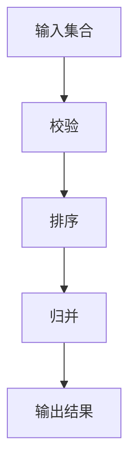

# 区间归并组件架构

## 组件职责

组件统一输入区间，提供正确且易用的结果。校验负责合法性，排序负责有序性，归并负责处理交叠。

## 接口设计

输入为整数半开区间集合，输出为归并后的集合。同步返回。无效输入整批拒绝，空集合返回空集合，原输入不被修改。

## 实现机制

采用校验、排序和归并三个处理步骤，通过清晰分工保证结果正确。

处理步骤互相配合，归并阶段按统一规则处理交叠。运行时使用临时资源，失败时返回错误。

## 设计验证

验证正常输入、异常输入、边界情况和输出一致性。组件的职责、接口和流程已经齐全，可交给开发人员实现。
