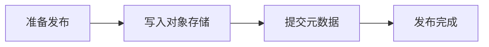

# 晴川公司内容发布协作

## 职责与实现

| 对象 | 职责 |
| --- | --- |
| 发布模块 | 校验请求、准备内容、发布和恢复 |
| 元数据 | 保存发布记录和状态 |
| 对象存储 | 保存内容 |

发布模块在既有应用进程内运行，与两种存储共同保障发布的一致性。系统通过发布标识避免重复，使用状态管理和故障恢复提高可靠性。

## 一次发布的运行

发布模块依次登记、上传和提交。成功后返回结果；异常时恢复并重试。启动时初始化依赖并恢复未完成发布。元数据与对象存储遵循一致的状态约定，调用方可以查询发布进度。

## 验证与限制

验证发布、重复、故障恢复和状态一致性。实际容量待测，其他功能划分、职责、流程和配图均已完整，设计可用于实施。
